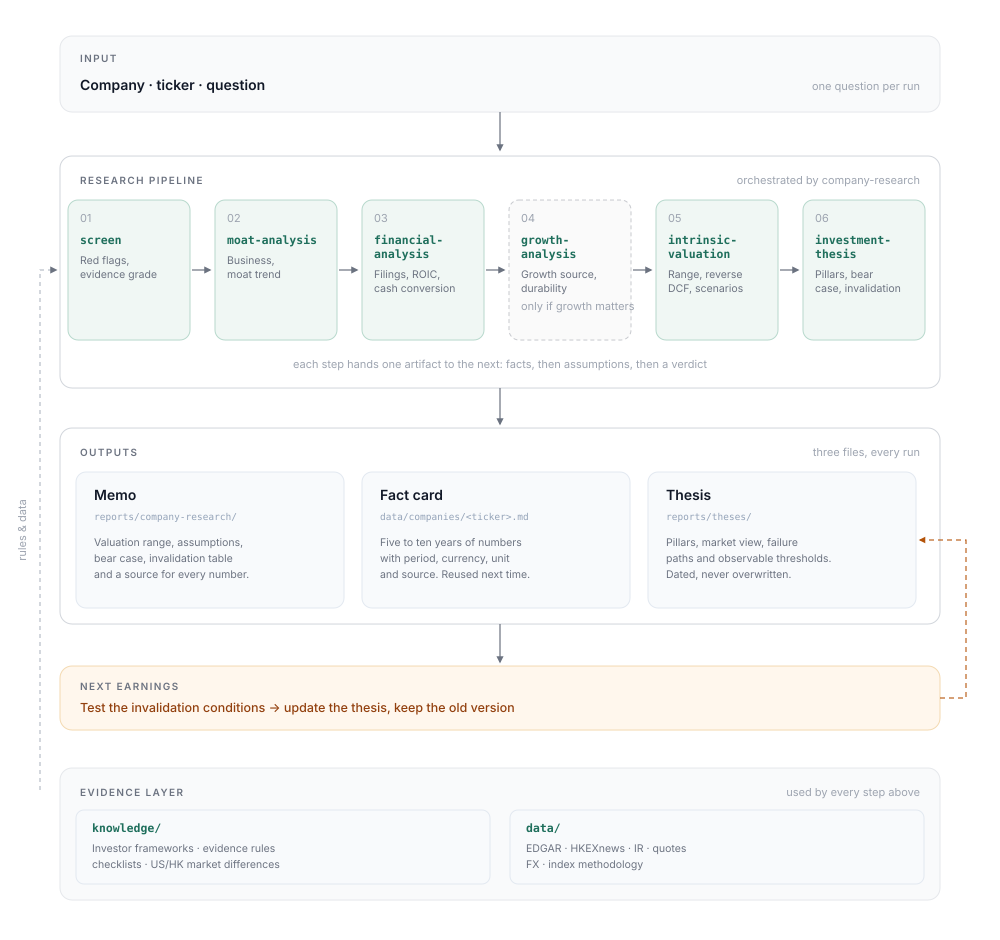

# Personal Investment OS

**English** | [中文](README.zh-CN.md)

Research US and Hong Kong listed companies with a process you can audit, repeat and falsify.

Eight Agent Skills built on Buffett, Munger and Duan Yongping, covering fundamental research, growth, ETFs and portfolio review. Works with Claude Code, Codex, DeepSeek Harness, Cursor, Gemini CLI and GitHub Copilot.

```bash
npx github:niexia/investment-skills install
```

Then just ask:

```
Research Tencent. Focus on gaming and how AI capex affects margins.
```

## What one run produces

- **Investment memo** — business, moat, financial quality, valuation range, market expectations, bear case, invalidation conditions, sources.
- **Fact card** — every number with period, currency, unit and source, ready for the next review.
- **Thesis** — a dated file that later earnings are tested against, instead of a fresh report with no memory.

No buy/sell signals. Every research ends in one of four states: `pass`, `conditional pass`, `grey zone`, `fail`.

## Skills

| Skill | Question it answers |
| --- | --- |
| `company-research` | What is this company worth, and why? |
| `financial-analysis` | Is the profit real? |
| `moat-analysis` | Is it a good business, and for how long? |
| `intrinsic-valuation` | What is priced in, and what is the margin of safety? |
| `investment-thesis` | What would prove this wrong? |
| `growth-analysis` | Is the growth structural or temporary? |
| `etf-analysis` | Is this index fund worth holding? |
| `portfolio-review` | Is the portfolio doing something stupid? |

Each skill works on its own. `company-research` chains them into one memo.

## How it works



`company-research` runs the pipeline in order: screen for red flags, then business and moat, then filings and financial quality, then growth (only when it matters), then a valuation range, then the thesis.

Each step hands a concrete artifact to the next — a normalized financial base, a moat verdict, growth assumptions — so the memo is assembled from evidence instead of generated in one pass. The knowledge base and the data layer feed every step rather than sitting in a separate retrieval stage.

Each full company research run leaves three core files: the memo, the company fact card and a dated thesis. Focused financial and ETF analyses use their own report templates. At the next earnings the thesis is tested against its own invalidation conditions, and the old version stays on disk.

## Install

**Any agent**

```bash
npx github:niexia/investment-skills install
```

The Agent Skills CLI works too:

```bash
npx skills add niexia/investment-skills
```

**Claude Code / Codex / Copilot CLI** — from the plugin marketplace:

```bash
claude plugin marketplace add niexia/investment-skills
claude plugin install investment-skills@niexia-investment
```

Other plugin marketplaces use their own commands; see [Installation](docs/install.md).

**No install** — clone the repository and start your agent inside it; the skills are already discoverable.

Working from a local clone? Run `./scripts/install-skills.sh` instead.

All channels, per-agent directories and troubleshooting: [`docs/install.md`](docs/install.md).

## First ten minutes

1. Set your limits in [`portfolio/allocation.md`](portfolio/allocation.md) — single position, sector and market caps.
2. Record what you own in [`portfolio/holdings.md`](portfolio/holdings.md).
3. Research a company you already know, and check whether the memo matches your own view.

## Repository

```
skills/          eight skills — the only source
knowledge/       investor frameworks, evidence rules, checklists, US/HK market rules
data/            source registry, company fact cards, templates
portfolio/       holdings and allocation policy
reports/         memos, financial analyses, ETF analyses, theses, portfolio reviews
docs/            installation, roadmap, open-source review
```

## Rules the system enforces

- Primary filings before media: SEC EDGAR, HKEXnews, company IR.
- Every number carries period, currency, unit and source.
- A valuation range with explicit assumptions, never a price target.
- A bear case and observable invalidation conditions in every memo.
- Unknown is allowed; pretending to know is not.

The full contract: [`knowledge/standards/output-contract.md`](knowledge/standards/output-contract.md).

## Docs

- [Installation](docs/install.md)
- [Roadmap](docs/roadmap.md)
- [Open-source review](docs/research/opensource-review.md)
- [Memo template](reports/_template/company-research.md)
- [Report templates](reports/README.md)

## Disclaimer

A personal research toolkit, not investment advice. No buy/sell signals, no price targets, no position sizing. Verify every number against the original filing. Investing involves risk.
