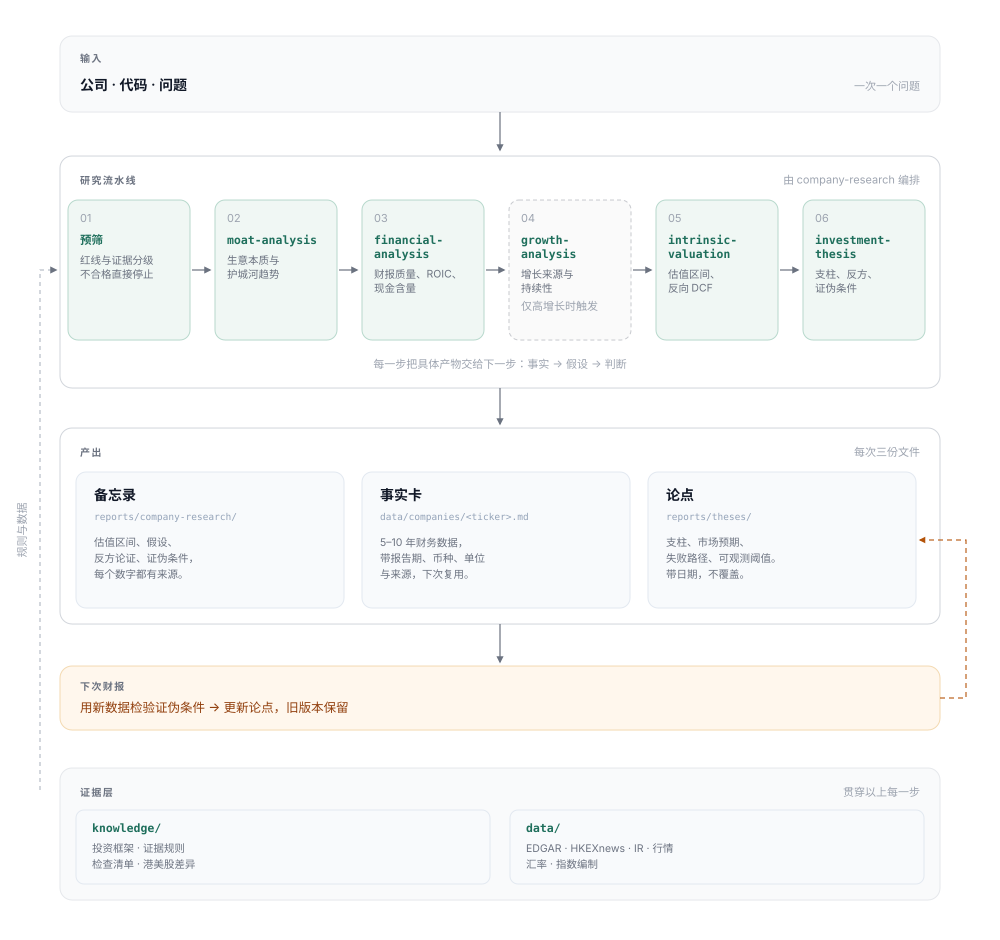

# Personal Investment OS

[English](README.md) | **中文**

用一套可复核、可重复、可证伪的流程，研究美股与港股公司。

八个 Agent Skills，基于巴菲特、芒格、段永平，覆盖基本面、成长、ETF 与组合复盘。Claude Code、Codex、DeepSeek Harness、Cursor、Gemini CLI、GitHub Copilot 都能用。

```bash
npx github:niexia/investment-skills install
```

然后直接问：

```
研究腾讯，重点看游戏和 AI 投入对利润率的影响。
```

## 一次研究会产出

- **投资备忘录**——生意、护城河、财务质量、估值区间、市场预期、反方论证、证伪条件、来源。
- **事实卡**——每个数字带报告期、币种、单位和来源，下次研究直接复用。
- **论点**——带日期的文件，后续财报拿来检验，而不是每次重写一篇没有记忆的报告。

不给买卖信号。每份研究的结论只有四档：`通过`、`有条件通过`、`灰色地带`、`不通过`。

## 八个 Skill

| Skill | 回答什么问题 |
| --- | --- |
| `company-research` | 这家公司值多少钱，为什么？ |
| `financial-analysis` | 利润是真的吗？ |
| `moat-analysis` | 是不是好生意，能好多久？ |
| `intrinsic-valuation` | 价格里已经包含了什么，还有多少安全边际？ |
| `investment-thesis` | 什么情况能证明我错了？ |
| `growth-analysis` | 增长是结构性的还是阶段性的？ |
| `etf-analysis` | 这只指数基金值得长期持有吗？ |
| `portfolio-review` | 组合有没有在做傻事？ |

每个都能单独用；`company-research` 把它们串成一份备忘录。

## 工作方式



`company-research` 按顺序执行：预筛红线 → 生意与护城河 → 财报与财务质量 → 成长（需要时才跑）→ 估值区间 → 论点。

每一步交给下一步一个具体产物——标准化财务基底、护城河结论、增长假设——所以备忘录是逐步组装的，不是一次生成的。知识库与数据层贯穿每一步，而不是单独的检索环节。

每次研究留下三个文件：备忘录、公司事实卡、带日期的论点。下次财报拿论点里的证伪条件逐条检验，旧版本保留。

## 安装

**任意 Agent**

```bash
npx github:niexia/investment-skills install
```

Agent Skills 生态的安装器同样可用：

```bash
npx skills add niexia/investment-skills
```

**Claude Code / Codex / Copilot CLI / Antigravity**——从插件市场安装：

```bash
claude plugin marketplace add niexia/investment-skills
claude plugin install investment-skills@niexia-investment
```

**不安装**——克隆仓库，在仓库目录里启动 Agent，skill 已就位。

在本地克隆里，也可以用 `./scripts/install-skills.sh` 安装。

全部渠道、各 Agent 目录与排错：[`docs/install.md`](docs/install.md)。

## 最初十分钟

1. 在 [`portfolio/allocation.md`](portfolio/allocation.md) 定下仓位、行业与市场的上限。
2. 在 [`portfolio/holdings.md`](portfolio/holdings.md) 记录当前持仓。
3. 研究一家你已经很熟悉的公司，看看备忘录和你的判断差在哪。

## 仓库结构

```
skills/          八个 skill，唯一源码
knowledge/       投资框架、证据规则、检查清单、港美股规则
data/            数据源登记、公司事实卡、模板
portfolio/       持仓与配置政策
reports/         备忘录、论点、组合复盘
docs/            安装、路线图、开源项目调研
```

## 系统强制的规则

- 原始披露优先于媒体：SEC EDGAR、HKEXnews、公司 IR。
- 每个数字都带报告期、币种、单位和来源。
- 只给带假设的估值区间，不给目标价。
- 每份备忘录都必须有反方论证和可观测的证伪条件。
- 允许写"不知道"，不允许把推测写成事实。

完整契约：[`knowledge/standards/output-contract.md`](knowledge/standards/output-contract.md)。

## 文档

- [安装](docs/install.md)
- [路线图](docs/roadmap.md)
- [开源项目调研](docs/research/opensource-review.md)
- [备忘录模板](reports/_template/company-research.md)

## 免责声明

个人研究工具，不构成投资建议。不提供买卖信号、目标价或仓位建议。所有数字请回到原始披露核对。投资有风险。
